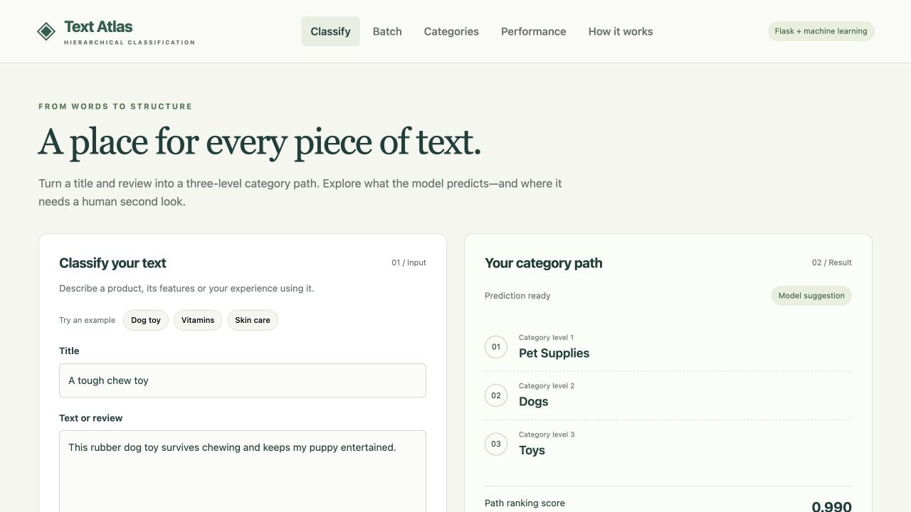
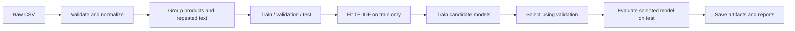
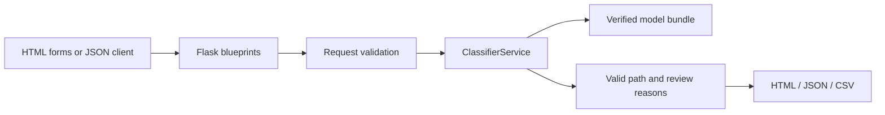
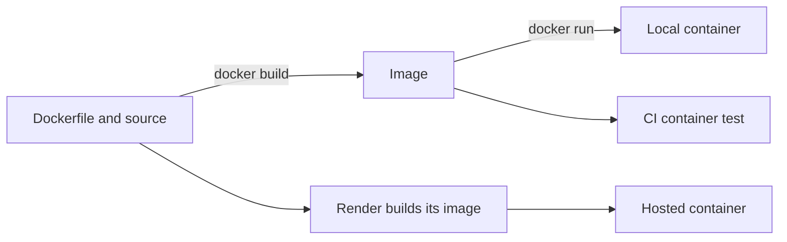
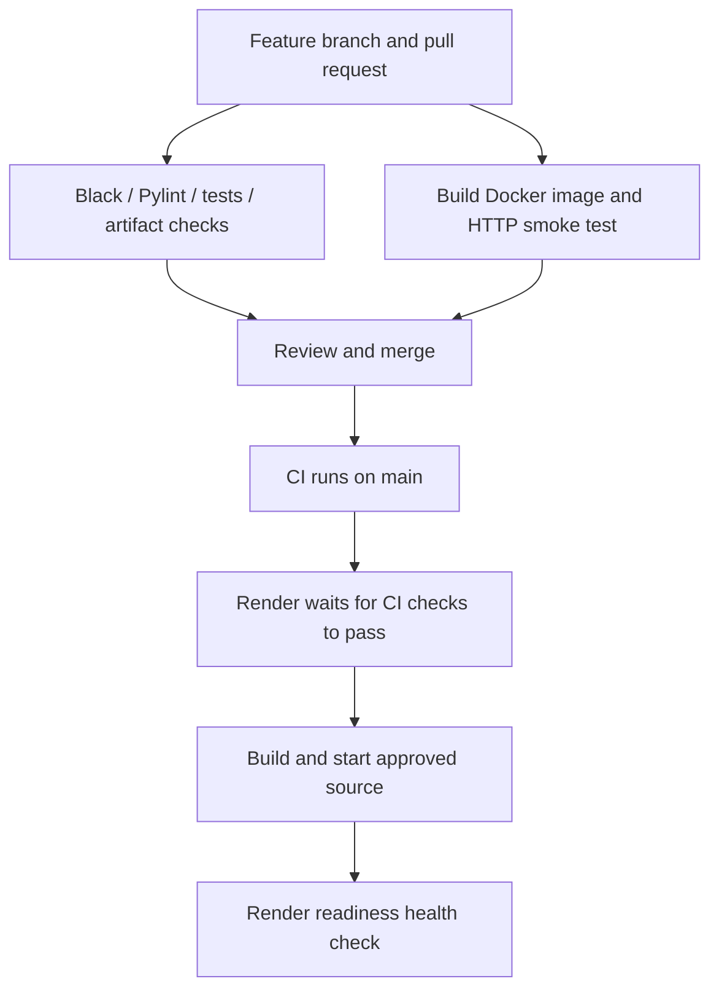
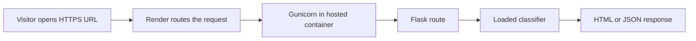
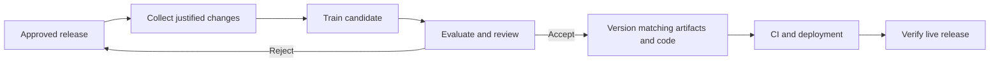

# Text Atlas — Hierarchical Text Classifier

A Flask web application and JSON API that organize English product-related titles and reviews into a valid three-level category path.

[](https://github.com/subhashdixit/hierarchical-text-classifier/actions/workflows/ci.yml)

**Live application:** [Open Text Atlas](https://hierarchical-text-classifier.onrender.com) · [GitHub Actions](https://github.com/subhashdixit/hierarchical-text-classifier/actions)

Hosted on Render’s free plan; the first request after inactivity may take 50 seconds or longer. The app also runs locally and in Docker using the commands below.

**Purpose:** turn an exploratory notebook into a reproducible, tested and deployable machine-learning application. This is a portfolio demonstration, not a production classification service with an availability guarantee.

## Contents

1. [Problem and scope](#1-problem-and-scope)
2. [Use the application](#2-use-the-application)
3. [Run locally](#3-run-locally)
4. [Understand the data](#4-understand-the-data)
5. [Machine-learning concepts and design](#5-machine-learning-concepts-and-design)
6. [Training and evaluation](#6-training-and-evaluation)
7. [Measured results](#7-measured-results)
8. [Architecture and repository structure](#8-architecture-and-repository-structure)
9. [Use the API](#9-use-the-api)
10. [Testing, formatting and Pylint](#10-testing-formatting-and-pylint)
11. [Docker](#11-docker)
12. [CI/CD explained](#12-cicd-explained)
13. [Deploy to Render](#13-deploy-to-render)
14. [Versioning, retraining and rollback](#14-versioning-retraining-and-rollback)
15. [Troubleshooting](#15-troubleshooting)
16. [Limitations, privacy and data rights](#16-limitations-privacy-and-data-rights)
17. [Learning sequence and future work](#17-learning-sequence-and-future-work)



## 1. Problem and scope

### First, understand the pieces

Think of this project as a small online classification desk. A visitor brings some text; the application uses a previously trained model to suggest where it belongs. Several tools cooperate, but each solves a different problem:

| Piece | Plain-language meaning | Its job in this project |
|---|---|---|
| Dataset | Examples with known answers | Teach and evaluate category prediction |
| Training | Learning patterns from examples | Produce model parameters and a vocabulary |
| Inference | Using learned patterns on new input | Classify a visitor's text without retraining |
| Flask | Python web framework | Receive requests and return pages or JSON |
| Gunicorn | Production WSGI server | Run the Flask application and handle web requests |
| Docker | Packaging and container runtime | Supply a consistent Python/application environment |
| Git / GitHub | Version history / remote collaboration platform | Track code, data/config changes and pull requests |
| GitHub Actions | Workflow runner | Execute automated checks and controlled training |
| Render | Hosting platform | Build and run the public web service |

**Building the app, training the model and deploying the app are three different activities.** Changing a button label needs a code release; it does not require retraining. Improving the model needs training and evaluation before its artifact is released.

Given a title and review text, predict `Cat1 → Cat2 → Cat3`. For example, text about a dog chew toy may map to `pet supplies → dogs → toys`. The taxonomy is fixed by the training data; the app cannot invent a new department or guarantee an appropriate category for unrelated text.

Potential users include catalogue analysts exploring text categorization and developers learning how a machine-learning workflow becomes a web application. This dataset contains product-related text, not a universal document-routing taxonomy.

**Acceptance criteria:** a working browser interface and API; valid supported paths; reproducible offline training; explicit held-out metrics; bounded batch uploads; useful input errors; automated tests and lint checks; containerized serving; documented deployment and rollback.

### What changed from the original notebook?

- Moved the original notebook to `notebooks/original_exploration.ipynb` and preserved its model files under `archive/legacy-models/`.
- Replaced label-as-text stacking with shared TF-IDF features and constrained path decoding. This avoids the original encoded-parent versus decoded-parent mismatch and in-sample parent-feature issue.
- Selected models using validation data, rather than repeatedly selecting against the test set.
- Grouped records by connected product IDs and normalized text to prevent overlap across partitions.
- Added a Flask application factory, blueprints, reusable services, input validation, batch downloads, model integrity checks, tests, Docker and CI workflows.
- Rebuilt the model from the existing dataset. Legacy pickle files are never loaded by the application.

## 2. Use the application

### Single prediction

1. Open the home page.
2. Enter a **Title**, **Text or review**, or both. A built-in example can fill the form.
3. Click **Classify text**.
4. Read all three category levels and expand alternative paths if useful.
5. Check review messages before accepting the result.

The **path ranking score is not a calibrated probability of correctness**. A score of 0.9 must not be interpreted as 90% reliable. Short inputs, low scores and `unknown` taxonomy labels trigger review messages. Text with no recognized vocabulary returns `unsupported`, rather than an arbitrary confident-looking category.

### Batch prediction

1. Download the sample from `/sample.csv` or use [data/examples/sample_batch.csv](data/examples/sample_batch.csv).
2. Use exact, case-sensitive columns `Title` and `Text`.
3. Upload a UTF-8 CSV on `/batch`.
4. Download predictions and review any rows marked `error` or `needs_review`.

```csv
Title,Text
Dog toy,A rubber chew toy for my dog
Vitamin tablets,Daily vitamins for nutrition and wellness
```

Limits: **2 MB**, **100 data rows**, **10,000 combined characters per record**. One invalid row does not discard valid rows. A malformed file or missing required columns rejects the file. Extra input columns are not returned. Downloaded text fields beginning with spreadsheet formula characters are escaped.

### Other pages

- `/categories`: filter training-supported paths and see example counts.
- `/performance`: inspect the recorded holdout metrics, candidate comparison and limitations.
- `/about`: read a plain-language explanation of the method.

### How to read a prediction responsibly

A valid path means the combination exists in the training taxonomy; it does not mean it is the correct answer for your text. Treat `needs_review` as an attention flag, not a guarantee that unflagged records are safe. If a prediction is unsuitable, add context, inspect alternatives or classify manually. This release does not save corrections or learn automatically from the visitor's next request.

## 3. Run locally

Use **Python 3.10 or 3.11**; CI tests both. Docker uses Python 3.11. A trained artifact is included, so serving does not require retraining or an API key.

```bash
git clone https://github.com/subhashdixit/hierarchical-text-classifier.git
cd hierarchical-text-classifier
python3 -m venv .venv
```

Activate the environment:

```bash
# macOS / Linux
source .venv/bin/activate
```

```powershell
# Windows PowerShell
.\.venv\Scripts\Activate.ps1
```

Install and check the environment:

```bash
python -m pip install --upgrade pip
python -m pip install -r requirements-dev.txt
python -m pip install --no-deps -e .
python -m pip check
python scripts/check_artifacts.py
```

Start the development server, then visit `http://127.0.0.1:8000`:

```bash
python -m flask --app hierarchical_classifier.web:create_app run --port 8000
```

For local debugging only, add `--debug`. Never expose Flask's development server or debugger as a production service.

Production-style serving on Linux/macOS:

```bash
gunicorn --config gunicorn.conf.py wsgi:app
```

Gunicorn is a Unix server; on Windows use Flask locally or Docker for production-style testing. If port 8000 is occupied, use `--port 8765` for Flask, or `PORT=8765 gunicorn --config gunicorn.conf.py wsgi:app` on Unix.

### Configuration

| Variable | Default | Purpose |
|---|---|---|
| `PORT` | `8000` | Gunicorn listening port |
| `APP_ROOT` | Repository root in editable installs | Locate reports and default artifact paths |
| `MODEL_DIR` | `<APP_ROOT>/models` | Approved artifact directory |

See [.env.example](.env.example). The app does **not** automatically read `.env`; export settings in your shell or configure them in your host. Docker sets its own paths. No secrets are required for inference.

### Why use a virtual environment and pinned dependencies?

A virtual environment gives this project its own Python packages, separate from other work on your computer. Version pins reduce surprises—for example, loading a saved model with an incompatible scikit-learn version. `pip check` detects incompatible installed dependency requirements; it does not test business behaviour or scan for vulnerabilities.

**Advantage:** easier troubleshooting and more repeatable setup. **Limitation:** a virtual environment does not package the operating system, and pins need maintenance as fixes are released. Docker addresses more of the runtime environment, but it still needs a compatible host and resource budget.

## 4. Understand the data

The preserved file is [data/raw/data.csv](data/raw/data.csv). It contains `productId`, `Title`, `userId`, `Time`, `Text`, `Cat1`, `Cat2` and `Cat3`.

| Field | Role |
|---|---|
| `Title`, `Text` | Model input |
| `Cat1`, `Cat2`, `Cat3` | Target labels |
| `productId` | Split grouping only; never an input feature |
| `userId`, `Time` | Excluded from model features |

The original dataset has 10,000 rows, 6 top-level labels, 64 second-level labels and 377 leaf-label names. A leaf name may appear under different parents; a **complete path** identifies its context.

The current cleaning run removes 5 blank-required-field records and 104 exact normalized-text/label repeats, leaving 9,891 rows. Repeated text with conflicting labels is retained and grouped together, not silently relabelled. There are 145 leaf-label names with fewer than five usable examples.

[Data documentation](data/README.md) describes provenance and rights limitations. The presence of a repository software license does not establish a license for the underlying review dataset.

### Features, targets, imbalance and leakage

- **Features** are information available when making a prediction: here, title and text.
- **Targets** are the answers used during learning: the three category labels. They must not be included in input text as an answer shortcut.
- **Class imbalance** means some categories have many more examples than others. Overall scores can look reasonable while uncommon categories perform badly.
- **Data leakage** means information unavailable in a genuine new case influences training or model selection. A near-identical product review in both train and test can make an evaluation easier than the real task.

Grouping records by products and repeated text makes the test closer to classifying unseen products. It reduces optimistic overlap, at the cost of uneven split sizes and less coverage of rare categories. It does not remove every source of bias, detect all paraphrased duplicates or simulate all future changes in the data.

## 5. Machine-learning concepts and design

### Text normalization

**Example:** a full-width `ＤＯＧ`, ordinary `DOG` and `dog` are normalized to a common form. Repeated spaces and line breaks are collapsed. This reduces accidental variations before feature extraction.

**Benefit:** fewer inconsistent representations, with exactly the same logic in training and serving. **Trade-off:** lowercasing removes case information that might matter for some tasks. More cleaning is not automatically better: removing every small word or punctuation pattern can also discard meaning.

One shared function normalizes Unicode, lowercases text and collapses whitespace. The title and body are combined in a fixed order. We avoid downloaded language resources, stemming and aggressive stop-word removal so the deployment has no NLTK download step and the transformation stays easy to reproduce.

### TF-IDF

A model needs numbers, not raw strings. TF-IDF assigns weights to words and word pairs. A term receives more weight when it is useful in one document but not common across every document. Roughly:

`TF-IDF(term, document) = term frequency × inverse document frequency`

The implementation uses scikit-learn's smoothed IDF and sublinear term frequency, up to 8,000 features, unigrams/bigrams, and `min_df=2`. The vocabulary is learned **only from training data**. Most entries are zero, so sparse matrices keep memory manageable.

#### A small TF-IDF example

Imagine many reviews contain “good”, while fewer contain “chew toy”. The rarer phrase may be more informative for a dog-toy category. A **unigram** is one token (`toy`); a **bigram** is a neighbouring pair (`chew toy`). This gives limited local word-order information.

For a term appearing in `df` of `N` training documents, the configured vectorizer uses smoothed `idf = log((1 + N) / (1 + df)) + 1`. For a positive term count, sublinear TF uses `1 + log(count)`. The resulting document vector is L2-normalized by the vectorizer. These are library defaults/configuration used here, not a manually coded alternative formula.

| Benefit | Limitation |
|---|---|
| Sparse features make CPU inference practical | Cannot represent rich context like a language model |
| Word weights can help investigate a decision | Different words with similar meaning may remain unrelated |
| Training-only vocabulary avoids fitting on held-out text | Previously unseen terms do not receive new features during serving |
| Bigrams capture short phrases | An 8,000-feature cap and `min_df=2` can discard rare but useful phrases |

The model does not use `productId` or `userId` to memorize a user's identity.

### Baselines and model comparison

- **Joint-path Multinomial Naive Bayes:** treat each observed full category path as a class. It is a fast baseline for nonnegative word features, but its conditional-independence assumption is simplistic.
- **Constrained level logistic regression:** train one classifier per level on the same text features. Logistic regression learns linear class boundaries in TF-IDF space. It is lightweight and works well as a transparent baseline for text.
- **Regularization:** compare `C=1` and `C=4`. Larger `C` means weaker regularization; validation data decides whether that helps.
- **Majority-path baseline:** always predict the most common training path. This establishes a basic reference point.

#### What the learning algorithms actually learn

**Multinomial Naive Bayes** estimates associations between nonnegative text features and a class. In the joint-path baseline, the class is an entire path. It is inexpensive to fit; its simplifying assumptions and fragmented rare-path examples limit what it can learn.

**Logistic regression** learns a weight for each feature/class combination. Scores are converted into class probabilities by the library. Fitting adjusts weights to reduce a regularized classification loss: penalize incorrect predictions while discouraging unnecessarily large coefficients. Despite its name, logistic regression is a **classification** algorithm here.

**Regularization** is a restraint against fitting training examples too closely. `C` is a hyperparameter selected before fitting; weights are parameters learned during fitting. We compare two `C` settings, not an exhaustive search over every algorithm. A stronger model is chosen by measured validation results, not by how complicated its name sounds.

| Approach | Strength in this project | Weakness to watch |
|---|---|---|
| Majority-path baseline | Almost no computation; establishes a minimum reference | Ignores the text and fails most other paths |
| Joint-path Naive Bayes | Simple complete-path baseline | Sparse examples for many path classes |
| Level logistic regression with constraints | Reuses evidence at broader levels and returns supported paths | Linear text features miss meaning; level scores are correlated |

**Overfitting:** strong training performance but weak performance on independent examples. **Underfitting:** a model is too restricted or its features too weak to capture useful patterns. Changing `C` may affect that balance, but it cannot manufacture missing training examples.

### Hierarchy-constrained decoding

Independent predictions can form incompatible category combinations. We score only complete paths observed in training. For path `(a,b,c)`:

`log_score(a,b,c) = log P(Cat1=a|text) + log P(Cat2=b|text) + log P(Cat3=c|text)`

Normalize these scores over allowed paths for ranking, then choose the highest. This is a heuristic combination of level models, not a calibrated joint posterior. The learned paths—not test labels—define valid combinations.

The configured review threshold `0.45` is an **illustrative heuristic**, not a clinically or commercially validated confidence threshold. A high score can still be wrong. The model recognizes `unknown` as a dataset label; it does not treat that label as a genuinely understood category.

#### Why constrain the hierarchy?

Suppose the best standalone department score points to pet supplies, but a separate leaf classifier prefers a skin-care label. Returning both would be structurally inconsistent. Constrained decoding compares complete allowed paths instead of assembling unrelated winners.

**Benefit:** every predicted path is internally valid. **Cost:** an unseen but legitimate new path cannot be returned. Restricting choices may also produce a plausible-looking wrong path for unrelated text. This is why validity, accuracy and uncertainty are documented separately.

### Why not an LLM or a separate API microservice?

The first objective is a reproducible fixed-taxonomy baseline with inexpensive CPU inference. Flask routes and the command line share the same prediction service. A separate service, embeddings or an LLM can be compared later if measured benefits justify their cost and complexity.

## 6. Training and evaluation

### Training, validation, testing and inference are different

Use an exam analogy: **training** is studying worked examples; **validation** is a mock exam used to choose an approach; the **test set** is a final exam kept out of that choice. **Inference** is using the chosen approach for a visitor's new question.

| Stage | What happens here | What must not happen |
|---|---|---|
| Training | Fit vocabulary, TF-IDF weights and classifier parameters | Fit on validation/test examples |
| Validation | Compare the three fitted candidate configurations | Repeatedly treat validation performance as guaranteed future performance |
| Final test | Report performance of the validation-selected artifact | Pick a new winner because its test score happens to look better |
| Serving / inference | Load the approved artifact and classify inputs | Silently retrain from user uploads |

The separation prevents a misleading evaluation where the model has effectively seen the answers already.



GroupShuffleSplit partitions connected components of shared products/text, approximately 60/20/20. Actual row counts differ because groups vary in size. Group-based splitting is intentionally **not stratified by the rare leaf labels**; some test labels are therefore absent from training. Those rows remain in evaluation and count as errors.

### Why the particular split used here?

A product can have several reviews, and repeated text can occur under different products. The grouping code connects those overlaps before splitting, so a chain of related records remains together. The random seed makes this group assignment repeatable; it does not prove the split is representative of every future population.

**Advantages:** clearer separation, reproducibility and a harder unseen-product test. **Disadvantages:** group sizes prevent perfectly equal proportions, rare labels may be missing from training, and one seed gives only one estimate. Group-aware cross-validation or an external/time-based test set would provide additional evidence; those are not implemented in this release.

### How the winner was chosen

| Candidate | Validation exact-path accuracy |
|---|---:|
| Joint-path Naive Bayes | 35.72% |
| Constrained logistic regression, C=1 | 34.62% |
| Constrained logistic regression, C=4 | 44.67% |

The C=4 candidate won **before** checking its final test result. Its test score of 46.63% can be slightly higher than validation because these partitions contain different examples; that alone does not indicate leakage or prove the model improved after selection.

Run training:

```bash
# Unix: bound numerical-library CPU usage
OPENBLAS_NUM_THREADS=1 OMP_NUM_THREADS=1 python -m hierarchical_classifier.ml.training
```

The same command without the environment prefixes works in PowerShell. Optional paths:

```bash
python -m hierarchical_classifier.ml.training \
  --data data/raw/data.csv \
  --config configs/training.yaml \
  --model-dir models \
  --report-dir reports
```

Candidate selection uses **validation exact-path accuracy**. The selected model is kept fitted on the training partition; it is not refitted on validation/test records. The final test report evaluates this artifact once in that run. Repeatedly tuning after looking at test results would eventually invalidate the holdout; reserve a new test set for future major experimentation.

Outputs:

| File | Purpose |
|---|---|
| `models/classifier.joblib` | TF-IDF, trained classifier and training taxonomy |
| `models/metadata.json` | Dataset/config/model hashes, versions and timestamp |
| `reports/metrics.json` | Candidate validation scores and selected-model test results |
| `reports/taxonomy.csv` | Allowed training paths and counts |
| `reports/split_manifest.csv` | Hashed text IDs, connected groups and split membership |
| `reports/test_predictions.csv` | Actual/predicted labels with hashed record IDs |

Command-line prediction:

```bash
python -m hierarchical_classifier.services.prediction \
  --title "Dog toy" --text "A rubber chew toy for my dog"
```

### Repeatability and its limits

The configuration, data hash, split manifest and model metadata help another developer reproduce the experiment. Floating-point libraries, CPU architecture and package changes can still create small numerical differences. A fixed seed is one ingredient of reproducibility, not a complete guarantee.

Training time is separate from prediction time. A saved model can answer many requests without learning again. Conversely, a working prediction endpoint does not prove the training data or evaluation design are sound.

## 7. Measured results

| Level | Accuracy | Macro F1 | Weighted F1 |
|---|---:|---:|---:|
| Cat1 | 0.8377 | 0.8146 | 0.8370 |
| Cat2 | 0.6322 | 0.3699 | 0.6138 |
| Cat3 | 0.5040 | 0.2006 | 0.4731 |

**Selected model:** `constrained_lr_c4`. **Exact-path test accuracy:** 46.63%. **Majority-path baseline:** 6.73%.

Split rows: train 5,810, validation 2,091, test 1,990. The serving taxonomy has 404 training-observed paths.

Exact-path accuracy requires **all three labels** to match. Macro F1 gives each label equal weight, exposing poor performance on rare classes; weighted F1 reflects their observed frequency. Scores are fractions from 0 to 1.

The model has 0% invalid predicted paths by construction, not because it classifies every record correctly. There are 49 test rows with true paths absent from training. Low-support paths are particularly weak; inspect [the full report](reports/metrics.json) before interpreting overall accuracy.

These results come from one fixed product/text-group split, not an external benchmark, deployment experiment or claim of production readiness. Timings in the report describe the training machine, not a latency guarantee on free hosting.

### Understand the metrics before judging the model

**Support** means the number of examples belonging to a class in the evaluated data. In a multiclass task, we can examine one category against all remaining categories to understand precision and recall.

#### Worked example: one category versus all others

This is an illustrative example—not this project's measured result. Suppose the category is “dog toys” and there are 100 reviews:

| Actual label | Predicted dog toys | Predicted something else |
|---|---:|---:|
| Dog toys | 30 true positives (TP) | 20 false negatives (FN) |
| Something else | 10 false positives (FP) | 40 true negatives (TN) |

| Metric | Calculation for this example | What it asks | Main limitation |
|---|---|---|---|
| Accuracy | `(TP + TN) / total = 70/100 = 70%` | How many answers are correct overall? | Frequent classes can dominate |
| Precision | `TP / (TP + FP) = 30/40 = 75%` | Of the items assigned to dog toys, how many belong there? | Does not reveal missed dog-toy examples |
| Recall | `TP / (TP + FN) = 30/50 = 60%` | Of the actual dog toys, how many were found? | Does not reveal how many wrong items were added |
| F1 | `2 × precision × recall / (precision + recall) ≈ 0.667` | How well are precision and recall balanced? | Ignores true negatives and does not encode business-specific error costs |

Precision matters when incorrect assignments are expensive; recall matters when missing relevant items is expensive. F1 penalizes a severe imbalance between them, but there is no universally “best” metric independent of the use case. Precision/recall are explained here as building blocks; the current JSON report stores F1/accuracy summaries rather than separate per-class precision/recall tables. See [the scikit-learn definitions](https://scikit-learn.org/1.6/modules/generated/sklearn.metrics.precision_recall_fscore_support.html).

#### Metrics actually reported by this project

| Metric | How we use it | Advantage | Disadvantage / interpretation trap |
|---|---|---|---|
| Per-level accuracy | Evaluate Cat1, Cat2 and Cat3 from the final decoded path | Shows where specificity becomes difficult | One level can be right while the full path is wrong |
| Macro F1 | Average each evaluated label's F1 equally | Exposes weak rare-category performance | Tiny classes can make the average unstable |
| Weighted F1 | Average class F1 weighted by true example counts | Describes performance under the observed class mix | Common labels can hide rare-label failures |
| Exact-path accuracy | Require all three labels on a record to match | Direct measure of a fully correct classification | Gives no partial credit for a correct department |
| Invalid-path rate | Count predicted paths outside the training taxonomy | Detects a structural failure in constrained decoding | Zero invalid paths does not imply correct predictions |
| Unseen-label/path counts | Keep test examples unsupported by training visible | Explains an important coverage limit | Counts are not a predictive-quality metric by themselves |
| Rare/common path slices | Compare results by training-path support | Reveals failures concealed by averages | Small slices have high uncertainty; threshold choice is illustrative |
| Prediction time per record | Time classifier prediction over a prepared test feature matrix | Helps compare model execution cost | Excludes text vectorization, HTTP/network time and hosting cold starts |

Macro F1 here averages labels present in the true **or predicted** evaluation values, following the scoring function's default. It does not always average all 377 original leaf-label names. With `zero_division=0`, undefined F1 cases contribute zero rather than producing an undefined result. Weighted F1 is an average of class-level F1 values, not F1 computed from averaged precision and recall.

#### Read our actual results as a story

- **Cat1 accuracy 83.77%:** about 1,667 of the 1,990 test records have the correct broad category after constrained decoding.
- **Exact-path accuracy 46.63%:** 928 records have all three labels correct. Broad-category success does not guarantee a usable fine-grained assignment.
- **Cat3 weighted F1 0.4731 versus macro F1 0.2006:** frequent leaf labels perform considerably better than the unweighted label average.
- **Majority-path baseline 6.73%:** compare this with full-path accuracy, not with top-level accuracy; they answer different questions.
- **49 test rows have unseen true paths:** these remain errors in the report, rather than being removed to inflate the score.

Do not multiply the three per-level accuracies to estimate full-path accuracy: errors at different levels are related. All displayed level metrics come from the final constrained predictions, not from three independently reported raw argmax outputs.

The low-support slice makes the weakness particularly clear:

| Test slice, based on full-path training count | Test rows | Correct complete paths | Accuracy |
|---|---:|---:|---:|
| Fewer than 5 training examples, including unseen paths | 188 | 1 | 0.53% |
| At least 5 training examples | 1,802 | 927 | 51.44% |

These are **full-path training counts**, different from the earlier count of globally rare leaf-label names. This model is a useful engineering baseline, but its rare-path results are not adequate evidence for unattended fine-grained business decisions.

#### Confusion matrix: which categories get mixed up?

A confusion matrix places actual categories on rows and predicted categories on columns. The diagonal represents correct classifications; off-diagonal cells show the direction of mistakes. In the recorded top-level matrix, 72 baby-product reviews are correctly classified, while 42 are assigned to health/personal care.

This helps decide whether to inspect ambiguous examples, labels or representation. Its limitation is size: a leaf-level matrix with hundreds of labels is hard to read. A top-level matrix alone also hides fine-grained mistakes. The current report provides the top-level matrix in [metrics.json](reports/metrics.json). [Confusion-matrix reference](https://scikit-learn.org/1.6/modules/generated/sklearn.metrics.confusion_matrix.html)

#### Model score versus measured accuracy

The UI's `0.990` path score for a particular example is a relative ranking within allowed paths. The test accuracy is a fraction of labelled records answered correctly. They are different quantities. Calibrated confidence would require a separate validation/calibration study; no such guarantee is implied by the displayed score.

## 8. Architecture and repository structure



Flask's **application factory** creates independent configured app instances, which makes testing easier. **Blueprints** group browser, API and health routes. Routes handle HTTP; services handle prediction; ML modules handle offline training. `ClassifierService` is a class because it owns loaded model state. Small transformations remain functions.

```text
src/hierarchical_classifier/
  config.py                 paths and application limits
  ml/
    data.py                 cleaning, grouping and splitting
    preprocessing.py        shared text transformations
    training.py             candidate training and selection
    evaluation.py           metrics and error accounting
    artifacts.py            bundle persistence and integrity checks
  services/
    prediction.py           reusable inference and command line
    taxonomy.py             model fitting and constrained decoding
    batch.py                CSV validation and safe downloads
  web/
    __init__.py             create_app(), error handling, response headers
    validation.py           HTTP input checks
    routes/                 pages, API, health blueprints
    templates/              Jinja HTML templates
    static/                 CSS and JavaScript
configs/                    training settings
models/                     approved serving artifacts
reports/                    measured results
scripts/                    artifact and HTTP smoke checks
tests/                      unit and integration tests
notebooks/                  original exploratory work
archive/                    original models and requirements
.github/workflows/          CI, training and deployment verification
Dockerfile                  production container
render.yaml                 Render deployment definition
```

The app loads the model once per worker. Gunicorn uses one process and two threads to bound memory. No database, user account, background training job or persistent upload directory is needed for this demonstration.

### Why these software design choices?

| Choice | Benefit | Cost or limit |
|---|---|---|
| Application factory | Create a fresh configured app for tests or deployment | Requires understanding initialization and configuration |
| Blueprints | Keep pages, API and health routes organized | Too many tiny blueprints can add unnecessary navigation |
| Reusable service class | Load model state once and reuse inference from different entry points | Must avoid hidden mutable request-specific state |
| Small pure functions | Easy to reason about and unit-test | Still need integration tests to check how pieces fit |
| Logging and explicit errors | Diagnose operational failures without exposing traces to users | Logs alone do not establish model quality; sensitive inputs must be omitted |
| One worker, two threads | Bound memory for a small hosting plan | Limited throughput; not a large-scale architecture |

The separation lets us change the HTML without retraining, or change the classifier behind a stable API contract. More folders do not automatically mean better design; each layer here has a concrete responsibility.

## 9. Use the API

Start the server first. Replace the local base URL with the deployed URL when available. Use `curl.exe` on Windows if PowerShell aliases `curl` to another command.

```bash
curl http://127.0.0.1:8000/health/live
curl http://127.0.0.1:8000/health/ready
curl -X POST http://127.0.0.1:8000/api/v1/predict \
  -H 'Content-Type: application/json' \
  -d '{"Title":"Dog toy","Text":"A rubber chew toy for my dog"}'
curl -X POST http://127.0.0.1:8000/api/v1/predict-batch \
  -F 'file=@data/examples/sample_batch.csv'
curl http://127.0.0.1:8000/api/v1/taxonomy
curl http://127.0.0.1:8000/api/v1/metrics
```

A successful prediction has `status`, `categories`, `path_score`, `alternatives`, `needs_review`, `review_reasons` and `model_version`. Unknown vocabulary returns HTTP 200 with `status: unsupported` and null categories; it is a valid request the model cannot support.

Errors: **400** invalid input/file, **413** oversized request, **404** missing endpoint, **405** wrong method, **503** unavailable model, **500** unexpected error. API error responses contain `error.code` and `error.message`. Detailed traces are not returned to visitors.

`/health/live` confirms the process responds. `/health/ready` is 200 only after a checksum/version-verified model loads; it also identifies the model version and the Render source revision when available. See [API contracts](docs/api.md).

### What is an API, and why also provide one?

An API is a documented way for another program to request a result. The browser interface is for people; JSON endpoints let scripts or another application use the same classifier. A **request** carries input, and a **response** carries output and an HTTP status.

For example, POST `/api/v1/predict` sends text for classification. GET `/api/v1/metrics` reads an existing report. `v1` identifies the contract version, not the model version. We can update a model while preserving the response structure; a breaking response change may need a new API version.

**Benefit:** reuse and automation. **Limitations:** callers must respect field names and size limits; a successful HTTP 200 can still contain `status: unsupported`, and a well-formed result can still be semantically wrong. Inspect both HTTP status and the response content.

## 10. Testing, formatting and Pylint

```bash
python -m black --check src tests scripts wsgi.py gunicorn.conf.py
python -m pylint src scripts wsgi.py gunicorn.conf.py
python -m pytest -q
python scripts/check_artifacts.py
python scripts/smoke_test.py --url http://127.0.0.1:8000 --attempts 3
```

Apply formatting with `python -m black src tests scripts wsgi.py gunicorn.conf.py`.

Tests cover product/text split separation, cleaning and duplicate counts, constrained category paths, unsupported input, model checksum failure, single/batch prediction, CSV formulas, HTTP errors, file limits, readiness failures, markup escaping and a complete small synthetic train/save/load run. The real checked-in artifact is exercised too. The smoke script checks a running HTTP server and an actual prediction; use `--expected-revision <commit-sha>` to reject a healthy but outdated deployment. It does not replace the unit tests.

The artifact check enforces zero recorded split overlap, zero invalid test paths, provenance hashes and fixed-dataset regression floors: at least 0.40 exact-path and 0.75 top-level accuracy, exceeding the majority-path baseline. Those are regression gates, **not production acceptance targets**. Any intentional data change requires reviewing these criteria.

Pylint checks application and operational Python code. Black checks tests as well. A small set of complexity rules is disabled explicitly in `pyproject.toml`; Gunicorn's required lowercase configuration names have a local documented exception. We do not disable all lint errors or treat a score alone as proof of quality.

### Different checks answer different questions

| Check | Question it answers | What it cannot establish |
|---|---|---|
| Black | Is Python formatted consistently? | Whether the logic is correct |
| Pylint | Are there suspicious patterns or maintainability problems? | That a model or business decision is correct |
| Unit test | Does a focused operation behave correctly? | That the entire deployed system works |
| Integration test | Do components work together? | Reliability on every real-world input |
| Container smoke test | Does the packaged server start and predict? | Comprehensive accuracy or load tolerance |
| Artifact check | Do hashes, reported split checks and regression floors match expectations? | Data rights, causality or performance on future data |
| Live deployment verifier | Is the expected source revision ready and able to predict? | Continuous availability after the check finishes |

A score of 10/10 from Pylint is useful hygiene, not a certification. Tests should protect important behaviour and real failure modes; adding many tests that repeat the implementation is not automatically valuable.

## 11. Docker

### What problem does Docker solve?

Without packaging, “it works on my laptop” may depend on a particular Python version, installed libraries or filesystem layout. Docker lets us describe and build an application environment that can be exercised locally, in CI and on the host.

Think of a **Dockerfile as the recipe**, an **image as the prepared package**, and a **container as one running instance**. An image does not start serving until a container is started from it. A container is not an entire independent virtual machine; it runs an isolated process environment on a compatible container platform. [Docker container basics](https://docs.docker.com/get-started/docker-concepts/the-basics/what-is-a-container/)



Here we use the **same Dockerfile**, not an immutable image digest promoted through every environment: Render rebuilds from Git. Floating base images and transitive dependencies mean builds at different times are not guaranteed byte-identical.

### Read our Dockerfile step by step

| Instruction or file | What it does in this repository |
|---|---|
| `FROM python:3.11-slim` | Start from a Python/Linux base rather than building the OS environment ourselves |
| `WORKDIR /app` | Give subsequent commands a predictable working directory |
| Copy requirements, then `RUN pip install` | Install application libraries in a reusable build layer |
| `COPY src`, models and metrics | Include serving code and its approved artifacts |
| `pip install --no-deps .` | Install our Python package after its dependencies |
| `ENV` | Set application paths, default port and numerical thread limits |
| `USER appuser` | Run the service without root privileges |
| `EXPOSE 8000` | Describe the default listening port; it does not publish a host port by itself |
| `HEALTHCHECK` | Probe model readiness at the configured runtime port |
| `CMD` | Start Gunicorn when the container runs |
| `.dockerignore` | Keep raw data, notebooks, legacy models and local files out of the build context |

The command `-p 8000:8000` maps **host port 8000 → container port 8000**. `--rm` removes the stopped container, not the source repository or its image. **Gunicorn runs the app, Docker packages/runs the process, and Render supplies the remote hosting environment.** [Dockerfile reference](https://docs.docker.com/reference/dockerfile/)

### Advantages and disadvantages

| Advantage | Corresponding limit or cost |
|---|---|
| A documented environment reduces setup differences | Compatible CPU architecture/runtime still matters |
| Test the packaged application before release | Building/downloading images takes time and disk space |
| Separate the service from unrelated local packages | Containers are not an absolute security boundary |
| Non-root operation and a small serving context reduce exposure | Base images and dependencies still need maintenance |
| Easy to replace a running container | Temporary writes disappear unless storage is deliberately externalized |

Our Compose setup adds a read-only filesystem with temporary `/tmp`. This is practical because this app does not need to save uploads. A future app with persistent records would need a suitable storage design, not an assumption that local container files survive restarts.

With Docker running:

```bash
docker build -t hierarchical-text-classifier:local .
docker run --rm -p 8000:8000 hierarchical-text-classifier:local
```

Or run the read-only Compose configuration:

```bash
docker compose up --build
# In another terminal
python scripts/smoke_test.py --url http://127.0.0.1:8000 --attempts 6
docker compose down
```

The image runs as a non-root user with Gunicorn, includes the approved model/report and excludes raw data, notebooks and old artifacts. The source checkout preserves those originals. Numerical thread counts are capped. Docker supports a read-only filesystem with a temporary `/tmp` mount. Container health checks call model readiness.

## 12. CI/CD explained

### Why automate this instead of copying files to a server?

Imagine changing preprocessing but forgetting that a saved model expects the previous representation. The page might still open while predictions fail. A repeatable pipeline checks the package, model and API behaviour before publishing changes, rather than relying on remembering every manual step.

- **Continuous integration (CI):** frequently integrate small code changes and run automated checks. In this project, GitHub Actions checks PRs and `main`.
- **Continuous delivery:** keep a validated release ready to deploy, with a deliberate release decision when needed.
- **Continuous deployment:** automatically publish accepted changes after the configured gates. Render performs this part here after main-branch CI passes.
- **Continuous training:** automatically retrain models as conditions change. This is a different capability and is **not** implemented here; training is manually triggered.

“Pipeline” simply means an ordered workflow. We have a **data/ML pipeline** that creates artifacts, a **request pipeline** that predicts, and a **CI/CD pipeline** that validates/releases software. They should not be confused.

**CI (continuous integration)** automatically checks proposed code changes. **CD (continuous deployment)** publishes a validated source revision. Neither is the same as model training.



| Workflow | Trigger | What it does |
|---|---|---|
| `ci.yml` — CI | Pull requests, pushes to main, manual | Python 3.10/3.11 formatting, lint, tests, artifact integrity and Docker HTTP smoke check |
| `train.yml` — Train candidate model | Manual | Train from versioned data/config, check results and upload a candidate bundle for 14 days; never auto-commit or promote it |
| `deploy.yml` — Verify live deployment | Manual | Smoke-test the `APP_URL` repository variable for readiness and an actual prediction |

Render's **After CI Checks Pass** setting performs automatic CD from `main`. Its health check runs during deployments. The separate live-prediction verifier is deliberately manual so it cannot create a pending check that waits for the deployment while Render waits for all checks to finish.

Actions are pinned to full commit hashes with version comments. Dependabot proposes package and action updates. CI runs `pip check` for dependency consistency; this is **not** a vulnerability scan. No scheduled production accuracy monitoring or automatic retraining is claimed.

**Main branch protection is enabled:** a pull request and all three named CI checks are required, including for administrators. Force pushes and branch deletion are blocked. This solo repository does not require an independent reviewer approval; review is still part of the documented contribution process. Merged feature branches are deleted automatically.

Typical contribution flow:

```bash
git switch -c feat/my-change
# edit code, then run the checks above
git add .
git commit -m "Describe the behavioural change"
git push -u origin feat/my-change
# Open a pull request, review checks and merge.
```

### What happens when a check fails?

A failed required PR check blocks merging under the configured protection. A failing main-branch check prevents Render's CI-gated auto-deploy. A readiness failure can prevent a new service instance from being promoted; it does not explain model accuracy.

A real example from this implementation: the first Linux container smoke check encountered a connection reset while the server was still starting. The pipeline exposed it, the smoke script gained bounded retries, and regression tests now cover startup resets and stale deployment revisions. The fix was tested before release rather than hiding the failure.

| Advantage of CI/CD | Disadvantage or operating responsibility |
|---|---|
| Consistent checks on every proposed change | Workflows require maintenance and consume runner/build resources |
| Small changes are easier to review and trace | A flawed test can consistently approve flawed behaviour |
| CI-gated releases reduce manual deployment mistakes | Green CI is not a guarantee of production quality |
| Logs show which stage failed | Too many noisy/slow checks discourage frequent changes |
| A commit connects code review to a deployment | Source control, host access and artifact compatibility still need protection |

The training workflow uploads a **candidate**, while deployment serves the **approved committed artifact**. A successful training job is not permission to silently change the public model. The live-verification workflow is manually run after deployment; continuous correctness monitoring is future work.

## 13. Deploy to Render

### Hosting versus deployment

**Hosting** is providing the remote computing environment that keeps an application accessible. **Deployment** is the operation of putting a particular application version into that environment and starting it successfully. Updating an already-hosted app is another deployment.

Your laptop is the development environment. GitHub stores versioned files. GitHub Actions checks changes. Docker defines the runtime package. Render hosts the running service at an HTTPS address. Closing your laptop does not stop the hosted application.



The hostname identifies the service; HTTPS encrypts traffic in transit. Render's routing and certificate handling remove work that we would otherwise configure ourselves. They do not assess whether a predicted category is correct.

### What Render manages, and what remains our responsibility

| Render handles for this service | We must still manage |
|---|---|
| Hosting the service and starting its container | Application/model correctness and compatible dependencies |
| Building from the linked source revision | Which source branch and CI gates are trusted |
| Public routing, HTTPS and operational logs | Privacy choices and what the application logs |
| Platform readiness checks and deployment history | A useful readiness endpoint and meaningful smoke tests |
| The selected free resource allocation | Memory/CPU limits, usage and a suitable availability expectation |

**Benefit:** deployment is simpler than administering a server ourselves. **Trade-offs:** platform-specific configuration, constrained resources, possible cold starts and dependence on the provider's policies. A free demonstration is not an always-on production service.

### Understand the free plan used here

At the documentation check on **30 October 2026**, Render's free web services sleep after 15 minutes without traffic and typically need about a minute to wake. A workspace receives 750 free running hours per calendar month, shared across its free services; sleeping services do not consume those hours, and unused hours do not roll over. Bandwidth and build limits are separate, and payment-method/overage settings matter. Review the live policy rather than assuming a multi-year price guarantee. [Current free-plan documentation](https://render.com/docs/free)

Sleeping does not erase the deployed source/model included in the image: they are available when it starts again. Runtime filesystem changes are ephemeral, so uploads or SQLite writes would not be durable. This classifier deliberately does not persist user inputs.

### Deployment steps for this project

GitHub stores the code and runs CI; **GitHub Pages cannot execute this Python backend**. Render provides the web process.

1. Sign in to Render and connect the GitHub repository using the Git Provider integration.
2. Create a Web Service from `subhashdixit/hierarchical-text-classifier`, branch `main`.
3. Select Docker and the Free instance type. Use the repository's `Dockerfile`.
4. Set the health-check path to `/health/ready`.
5. Set automatic deployments to **After CI Checks Pass**.
6. Deploy after the main-branch CI succeeds; inspect startup/build logs.
7. Visit the assigned HTTPS URL and classify an example.
8. Set GitHub Actions repository variable `APP_URL` to that actual URL.
9. Run **Verify live deployment** in Actions, or run the smoke script locally against that URL.

[render.yaml](render.yaml) records the same free Docker settings for Blueprint-based setup. Do not select a paid plan accidentally; no database or persistent disk is required. If account/provider access is unavailable, configuration alone is not evidence of deployment: confirm the actual URL before claiming the app is live.

Free web services can sleep after inactivity and have resource limits. Expect cold starts; do not promise continuous availability. See [Render free-service limits](https://render.com/docs/free) and [CI-gated deployments](https://render.com/docs/deploys).

## 14. Versioning, retraining and rollback

### Why version more than the source code?

A model is only one part of a working prediction system. The same weights can behave differently if tokenization, feature order, taxonomy, library versions or decoding logic change. A **release** therefore needs a matched set of components.

| Version or record | Question it answers | Limitation |
|---|---|---|
| Git commit | Which source/configuration files were used? | Does not by itself verify external data or rebuild identical bytes |
| Dependency pins | Which direct package versions are expected? | Our transitive environment/base image is not fully locked |
| Dataset/config SHA-256 | Are these bytes the same as the recorded inputs? | A hash does not prove data correctness, rights or quality |
| Model version and artifact hash | Which approved model bundle is this? | The friendly version string must be maintained when promoting releases |
| Metrics and split manifest | What evidence accompanied the model? | Old evidence may stop representing new real-world traffic |
| Deployed revision in readiness | Which source commit is the hosted process running? | A healthy process may still make inaccurate predictions |

An API version such as `/api/v1/` describes a response contract; `model_version: 1.0.0` identifies a model release. They are related but not interchangeable. A documentation-only commit can have a new Git revision with the same model version.

### Retraining: when and why?

**Retraining** fits a new candidate using a deliberate data/configuration change. **Data drift** means the incoming input distribution has changed; **concept drift** means the relationship between input and desired labels has changed. New product categories, vocabulary and corrected labels are practical reasons to investigate a new model.

Retraining is not automatically beneficial. More data may contain errors; more complex features may increase memory; a model may improve common classes while harming rare ones. Evaluate the candidate against the current approved model, inspect error slices and only then promote it. A threshold or UI change alone does not necessarily require retraining.



**Advantage:** adapt to improved evidence or a changing task. **Disadvantages:** compute/review cost, comparability challenges when data changes, and the danger of fitting repeated experiments to the same test set. There is no automatic retraining or feedback-learning loop in this app.

### Rollback: recover a known working release

A **rollback** restores an earlier matched release when a new one is faulty. It differs from **retraining**, which creates a new model, and from **rolling forward**, which ships a corrective update.

Example: a code change alters text preprocessing and predictions become unreliable. Restoring only an older model may leave the mismatched preprocessing in place. Revert the complete release—code, model, configuration and compatible dependencies—and verify the restored service.

**Advantage:** fast recovery when the previous release is known to work. **Limitations:** it can restore old bugs or obsolete categories; it cannot undo external actions already taken from predictions. Systems with databases need migration/data-compatibility planning as well. This particular application has no persistent user database, which makes its rollback simpler.

A release comprises source code, pinned direct dependencies, training configuration, dataset hash, model hash, metadata and reports. `joblib` artifacts are executable serialization: only load the trusted repository-produced bundle. A SHA-256 check detects accidental changes; it is **not a cryptographic signature** against a malicious replacement of both metadata and model.

To retrain:

1. Work on a branch and update data/config/code deliberately.
2. Run training locally or use **Train candidate model** in Actions.
3. Inspect validation and test metrics, rare/unseen support, errors and model size. Avoid repeated test-set-driven tuning.
4. Review the candidate artifact with the source revision that produced it. Update `model_version` when promoting a genuinely new release.
5. Commit approved `models/`, `reports/`, configuration and corresponding code together through a reviewed PR.
6. CI checks the new bundle. Merge, let Render deploy, then verify the live revision.

Training overwrites the specified local output directories. Use `--model-dir /tmp/candidate-model --report-dir /tmp/candidate-report` to keep the approved bundle untouched during experiments.

To roll back, revert the complete source/artifact release commit through a PR, run CI and redeploy. Do not revert only the model while leaving incompatible preprocessing or dependencies. Render also exposes previous deploys in its dashboard; after an operational rollback, reconcile GitHub to the intended version to avoid a later auto-deploy restoring the bad revision.

### Practical release decisions

| Situation | Appropriate action |
|---|---|
| Improve README wording | Documentation PR; no model retraining required |
| Change a form or validation message | Code PR and relevant tests; keep the model if compatible |
| Change preprocessing or vocabulary | Retrain/evaluate a matching artifact before promotion |
| Introduce new categories | Check data coverage and update the learned taxonomy through training |
| Discover a defective deployed release | Roll back a matched version or roll forward with a tested fix |
| See a single wrong prediction | Investigate the example; do not assume an infrastructure restart will improve the model |

Rollback is a recovery tool, not a replacement for prevention, evaluation or investigation.

## 15. Troubleshooting

| Symptom | What to check |
|---|---|
| `ModuleNotFoundError: hierarchical_classifier` | Activate the environment and run `pip install --no-deps -e .` |
| Model checksum/version error | Restore the matched model/metadata and install the pinned scikit-learn version; do not bypass the check |
| `/health/live` works but readiness is 503 | Check model paths and startup logs; model loading failed |
| App cannot find reports after wheel installation | Set `APP_ROOT` to the checkout root; Docker config already does this |
| Port already in use | Use another Flask port or Gunicorn `PORT` |
| CSV rejected | Check UTF-8, exact headers, row count and 2 MB limit |
| Wrong/uncertain category | Add descriptive in-domain text; inspect rare labels and alternatives; a high ranking score is not guaranteed correctness |
| Deployment not updating | Confirm linked main branch, passing CI, Git provider connection and Render deploy events |
| First request is slow | A free hosting instance may be waking from sleep |
| Docker denied access to buildx cache locally | Use a writable `BUILDX_CONFIG` directory or fix local Docker filesystem access; CI uses its own runner |

## 16. Limitations, privacy and data rights

- Public CPU demo without authentication, user quotas, billing, persistent history or production-grade abuse protection. Request/file limits are implemented; per-user rate limiting is not.
- English product-related text only; language and out-of-domain detection are not comprehensive.
- Rare categories and unseen paths cannot be reliably classified. Category constraints guarantee path validity, not semantic correctness.
- Uploaded text is processed in memory; application code does not persist or log it. Hosting infrastructure may record operational metadata. Do not submit confidential or personal data.
- No external paid API is called for inference. Original dataset rights and provenance are not verified; avoid commercial redistribution until clarified.
- The Apache-2.0 software license is retained. It does not automatically grant rights to third-party data, review text or original assets.
- Direct application dependency versions are pinned; transitive packages and the Python Docker base are not a fully locked supply chain. Review updates and rebuilds before deploying.

### Engineering success versus modelling success

A deployed page, passing tests and a reproducible model are engineering milestones. Reliable category predictions on representative future data are a separate modelling objective. This project intentionally reports its weaknesses rather than treating a running website as proof that the machine-learning task is solved.

## 17. Learning sequence and future work

### A guided first learning session

1. **Use:** try an example in the UI, then submit unrelated text and inspect the difference between an error and `unsupported`.
2. **Inspect data:** identify features versus target labels; compare common and rare category support.
3. **Follow inference:** read `combine_text`, TF-IDF transformation and constrained decoding in that order.
4. **Interpret results:** calculate the toy precision/recall example above, then inspect macro versus weighted F1 in the actual report.
5. **Understand training:** trace where train/validation/test data are used and where they are deliberately excluded.
6. **Understand the web layer:** follow a form submission through a Flask route and the shared service; compare the JSON endpoint.
7. **Run checks:** use the existing commands and read which question each check answers.
8. **Package:** build and run the Docker image; identify what is inside versus excluded.
9. **Trace release:** open a merged PR, its Actions checks and the corresponding Render revision.
10. **Experiment safely:** use a branch and separate candidate output directories; review evidence before changing the approved model.

These steps teach the existing implementation. Future capabilities listed below remain proposals rather than hidden completed features.

Read the requirements, run the UI, call the API, follow preprocessing → TF-IDF → classification → constrained decoding, inspect metrics, run tests, build Docker, then inspect Actions and Render logs. Change one thing on a branch and observe the pipeline before attempting a model change.

Useful future work: stronger data provenance, improved rare-category handling, group-aware cross-validation, calibrated uncertainty/abstention, a new external holdout, richer domain-shift checks, rate limiting, automated vulnerability scanning and monitored release promotion. These are future improvements, not completed features.

Supporting guides: [requirements](docs/requirements.md), [architecture](docs/architecture.md), [API](docs/api.md), [model card](docs/model-card.md), [deployment](docs/deployment.md), [contributing](CONTRIBUTING.md).
