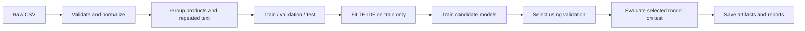
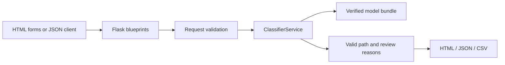
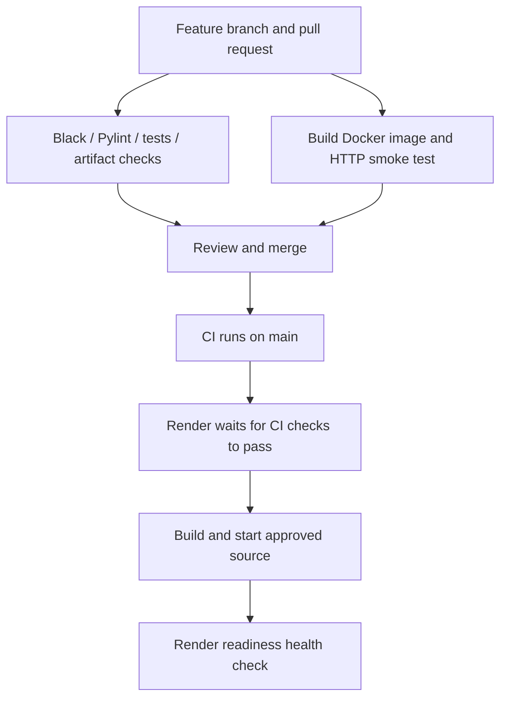

# Text Atlas — Hierarchical Text Classifier

A Flask web application and JSON API that organize English product-related titles and reviews into a valid three-level category path.

[](https://github.com/subhashdixit/hierarchical-text-classifier/actions/workflows/ci.yml)

**Deployment:** configuration is ready for Render; a verified live URL will be added after deployment succeeds. The app runs locally and in Docker using the commands below.

**Purpose:** turn an exploratory notebook into a reproducible, tested and deployable machine-learning application. This is a portfolio demonstration, not a production classification service with an availability guarantee.

## Contents

1. [Problem and scope](#1-problem-and-scope)
2. [Use the application](#2-use-the-application)
3. [Run locally](#3-run-locally)
4. [Understand the data](#4-understand-the-data)
5. [Machine-learning concepts and design](#5-machine-learning-concepts-and-design)
6. [Training and evaluation](#6-training-and-evaluation)
7. [Measured results](#7-measured-results)
8. [Architecture and repository structure](#8-architecture-and-repository-structure)
9. [Use the API](#9-use-the-api)
10. [Testing, formatting and Pylint](#10-testing-formatting-and-pylint)
11. [Docker](#11-docker)
12. [CI/CD explained](#12-cicd-explained)
13. [Deploy to Render](#13-deploy-to-render)
14. [Versioning, retraining and rollback](#14-versioning-retraining-and-rollback)
15. [Troubleshooting](#15-troubleshooting)
16. [Limitations, privacy and data rights](#16-limitations-privacy-and-data-rights)
17. [Learning sequence and future work](#17-learning-sequence-and-future-work)


## 1. Problem and scope

Given a title and review text, predict `Cat1 → Cat2 → Cat3`. For example, text about a dog chew toy may map to `pet supplies → dogs → toys`. The taxonomy is fixed by the training data; the app cannot invent a new department or guarantee an appropriate category for unrelated text.

Potential users include catalogue analysts exploring text categorization and developers learning how a machine-learning workflow becomes a web application. This dataset contains product-related text, not a universal document-routing taxonomy.

**Acceptance criteria:** a working browser interface and API; valid supported paths; reproducible offline training; explicit held-out metrics; bounded batch uploads; useful input errors; automated tests and lint checks; containerized serving; documented deployment and rollback.

### What changed from the original notebook?

- Moved the original notebook to `notebooks/original_exploration.ipynb` and preserved its model files under `archive/legacy-models/`.
- Replaced label-as-text stacking with shared TF-IDF features and constrained path decoding. This avoids the original encoded-parent versus decoded-parent mismatch and in-sample parent-feature issue.
- Selected models using validation data, rather than repeatedly selecting against the test set.
- Grouped records by connected product IDs and normalized text to prevent overlap across partitions.
- Added a Flask application factory, blueprints, reusable services, input validation, batch downloads, model integrity checks, tests, Docker and CI workflows.
- Rebuilt the model from the existing dataset. Legacy pickle files are never loaded by the application.

## 2. Use the application

### Single prediction

1. Open the home page.
2. Enter a **Title**, **Text or review**, or both. A built-in example can fill the form.
3. Click **Classify text**.
4. Read all three category levels and expand alternative paths if useful.
5. Check review messages before accepting the result.

The **path ranking score is not a calibrated probability of correctness**. A score of 0.9 must not be interpreted as 90% reliable. Short inputs, low scores and `unknown` taxonomy labels trigger review messages. Text with no recognized vocabulary returns `unsupported`, rather than an arbitrary confident-looking category.

### Batch prediction

1. Download the sample from `/sample.csv` or use [data/examples/sample_batch.csv](data/examples/sample_batch.csv).
2. Use exact, case-sensitive columns `Title` and `Text`.
3. Upload a UTF-8 CSV on `/batch`.
4. Download predictions and review any rows marked `error` or `needs_review`.

```csv
Title,Text
Dog toy,A rubber chew toy for my dog
Vitamin tablets,Daily vitamins for nutrition and wellness
```

Limits: **2 MB**, **100 data rows**, **10,000 combined characters per record**. One invalid row does not discard valid rows. A malformed file or missing required columns rejects the file. Extra input columns are not returned. Downloaded text fields beginning with spreadsheet formula characters are escaped.

### Other pages

- `/categories`: filter training-supported paths and see example counts.
- `/performance`: inspect the recorded holdout metrics, candidate comparison and limitations.
- `/about`: read a plain-language explanation of the method.

## 3. Run locally

Use **Python 3.10 or 3.11**; CI tests both. Docker uses Python 3.11. A trained artifact is included, so serving does not require retraining or an API key.

```bash
git clone https://github.com/subhashdixit/hierarchical-text-classifier.git
cd hierarchical-text-classifier
python3 -m venv .venv
```

Activate the environment:

```bash
# macOS / Linux
source .venv/bin/activate
```

```powershell
# Windows PowerShell
.\.venv\Scripts\Activate.ps1
```

Install and check the environment:

```bash
python -m pip install --upgrade pip
python -m pip install -r requirements-dev.txt
python -m pip install --no-deps -e .
python -m pip check
python scripts/check_artifacts.py
```

Start the development server, then visit `http://127.0.0.1:8000`:

```bash
python -m flask --app hierarchical_classifier.web:create_app run --port 8000
```

For local debugging only, add `--debug`. Never expose Flask's development server or debugger as a production service.

Production-style serving on Linux/macOS:

```bash
gunicorn --config gunicorn.conf.py wsgi:app
```

Gunicorn is a Unix server; on Windows use Flask locally or Docker for production-style testing. If port 8000 is occupied, use `--port 8765` for Flask, or `PORT=8765 gunicorn --config gunicorn.conf.py wsgi:app` on Unix.

### Configuration

| Variable | Default | Purpose |
|---|---|---|
| `PORT` | `8000` | Gunicorn listening port |
| `APP_ROOT` | Repository root in editable installs | Locate reports and default artifact paths |
| `MODEL_DIR` | `<APP_ROOT>/models` | Approved artifact directory |

See [.env.example](.env.example). The app does **not** automatically read `.env`; export settings in your shell or configure them in your host. Docker sets its own paths. No secrets are required for inference.

## 4. Understand the data

The preserved file is [data/raw/data.csv](data/raw/data.csv). It contains `productId`, `Title`, `userId`, `Time`, `Text`, `Cat1`, `Cat2` and `Cat3`.

| Field | Role |
|---|---|
| `Title`, `Text` | Model input |
| `Cat1`, `Cat2`, `Cat3` | Target labels |
| `productId` | Split grouping only; never an input feature |
| `userId`, `Time` | Excluded from model features |

The original dataset has 10,000 rows, 6 top-level labels, 64 second-level labels and 377 leaf-label names. A leaf name may appear under different parents; a **complete path** identifies its context.

The current cleaning run removes 5 blank-required-field records and 104 exact normalized-text/label repeats, leaving 9,891 rows. Repeated text with conflicting labels is retained and grouped together, not silently relabelled. There are 145 leaf-label names with fewer than five usable examples.

[Data documentation](data/README.md) describes provenance and rights limitations. The presence of a repository software license does not establish a license for the underlying review dataset.

## 5. Machine-learning concepts and design

### Text normalization

One shared function normalizes Unicode, lowercases text and collapses whitespace. The title and body are combined in a fixed order. We avoid downloaded language resources, stemming and aggressive stop-word removal so the deployment has no NLTK download step and the transformation stays easy to reproduce.

### TF-IDF

A model needs numbers, not raw strings. TF-IDF assigns weights to words and word pairs. A term receives more weight when it is useful in one document but not common across every document. Roughly:

`TF-IDF(term, document) = term frequency × inverse document frequency`

The implementation uses scikit-learn's smoothed IDF and sublinear term frequency, up to 8,000 features, unigrams/bigrams, and `min_df=2`. The vocabulary is learned **only from training data**. Most entries are zero, so sparse matrices keep memory manageable.

### Baselines and model comparison

- **Joint-path Multinomial Naive Bayes:** treat each observed full category path as a class. It is a fast baseline for nonnegative word features, but its conditional-independence assumption is simplistic.
- **Constrained level logistic regression:** train one classifier per level on the same text features. Logistic regression learns linear class boundaries in TF-IDF space. It is lightweight and works well as a transparent baseline for text.
- **Regularization:** compare `C=1` and `C=4`. Larger `C` means weaker regularization; validation data decides whether that helps.
- **Majority-path baseline:** always predict the most common training path. This establishes a basic reference point.

### Hierarchy-constrained decoding

Independent predictions can form incompatible category combinations. We score only complete paths observed in training. For path `(a,b,c)`:

`log_score(a,b,c) = log P(Cat1=a|text) + log P(Cat2=b|text) + log P(Cat3=c|text)`

Normalize these scores over allowed paths for ranking, then choose the highest. This is a heuristic combination of level models, not a calibrated joint posterior. The learned paths—not test labels—define valid combinations.

The configured review threshold `0.45` is an **illustrative heuristic**, not a clinically or commercially validated confidence threshold. A high score can still be wrong. The model recognizes `unknown` as a dataset label; it does not treat that label as a genuinely understood category.

### Why not an LLM or a separate API microservice?

The first objective is a reproducible fixed-taxonomy baseline with inexpensive CPU inference. Flask routes and the command line share the same prediction service. A separate service, embeddings or an LLM can be compared later if measured benefits justify their cost and complexity.

## 6. Training and evaluation



GroupShuffleSplit partitions connected components of shared products/text, approximately 60/20/20. Actual row counts differ because groups vary in size. Group-based splitting is intentionally **not stratified by the rare leaf labels**; some test labels are therefore absent from training. Those rows remain in evaluation and count as errors.

Run training:

```bash
# Unix: bound numerical-library CPU usage
OPENBLAS_NUM_THREADS=1 OMP_NUM_THREADS=1 python -m hierarchical_classifier.ml.training
```

The same command without the environment prefixes works in PowerShell. Optional paths:

```bash
python -m hierarchical_classifier.ml.training \
  --data data/raw/data.csv \
  --config configs/training.yaml \
  --model-dir models \
  --report-dir reports
```

Candidate selection uses **validation exact-path accuracy**. The selected model is kept fitted on the training partition; it is not refitted on validation/test records. The final test report evaluates this artifact once in that run. Repeatedly tuning after looking at test results would eventually invalidate the holdout; reserve a new test set for future major experimentation.

Outputs:

| File | Purpose |
|---|---|
| `models/classifier.joblib` | TF-IDF, trained classifier and training taxonomy |
| `models/metadata.json` | Dataset/config/model hashes, versions and timestamp |
| `reports/metrics.json` | Candidate validation scores and selected-model test results |
| `reports/taxonomy.csv` | Allowed training paths and counts |
| `reports/split_manifest.csv` | Hashed text IDs, connected groups and split membership |
| `reports/test_predictions.csv` | Actual/predicted labels with hashed record IDs |

Command-line prediction:

```bash
python -m hierarchical_classifier.services.prediction \
  --title "Dog toy" --text "A rubber chew toy for my dog"
```

## 7. Measured results

| Level | Accuracy | Macro F1 | Weighted F1 |
|---|---:|---:|---:|
| Cat1 | 0.8377 | 0.8146 | 0.8370 |
| Cat2 | 0.6322 | 0.3699 | 0.6138 |
| Cat3 | 0.5040 | 0.2006 | 0.4731 |

**Selected model:** `constrained_lr_c4`. **Exact-path test accuracy:** 46.63%. **Majority-path baseline:** 6.73%.

Split rows: train 5,810, validation 2,091, test 1,990. The serving taxonomy has 404 training-observed paths.

Exact-path accuracy requires **all three labels** to match. Macro F1 gives each label equal weight, exposing poor performance on rare classes; weighted F1 reflects their observed frequency. Scores are fractions from 0 to 1.

The model has 0% invalid predicted paths by construction, not because it classifies every record correctly. There are 49 test rows with true paths absent from training. Low-support paths are particularly weak; inspect [the full report](reports/metrics.json) before interpreting overall accuracy.

These results come from one fixed product/text-group split, not an external benchmark, deployment experiment or claim of production readiness. Timings in the report describe the training machine, not a latency guarantee on free hosting.

## 8. Architecture and repository structure



Flask's **application factory** creates independent configured app instances, which makes testing easier. **Blueprints** group browser, API and health routes. Routes handle HTTP; services handle prediction; ML modules handle offline training. `ClassifierService` is a class because it owns loaded model state. Small transformations remain functions.

```text
src/hierarchical_classifier/
  config.py                 paths and application limits
  ml/
    data.py                 cleaning, grouping and splitting
    preprocessing.py        shared text transformations
    training.py             candidate training and selection
    evaluation.py           metrics and error accounting
    artifacts.py            bundle persistence and integrity checks
  services/
    prediction.py           reusable inference and command line
    taxonomy.py             model fitting and constrained decoding
    batch.py                CSV validation and safe downloads
  web/
    __init__.py             create_app(), error handling, response headers
    validation.py           HTTP input checks
    routes/                 pages, API, health blueprints
    templates/              Jinja HTML templates
    static/                 CSS and JavaScript
configs/                    training settings
models/                     approved serving artifacts
reports/                    measured results
scripts/                    artifact and HTTP smoke checks
tests/                      unit and integration tests
notebooks/                  original exploratory work
archive/                    original models and requirements
.github/workflows/          CI, training and deployment verification
Dockerfile                  production container
render.yaml                 Render deployment definition
```

The app loads the model once per worker. Gunicorn uses one process and two threads to bound memory. No database, user account, background training job or persistent upload directory is needed for this demonstration.

## 9. Use the API

Start the server first. Replace the local base URL with the deployed URL when available. Use `curl.exe` on Windows if PowerShell aliases `curl` to another command.

```bash
curl http://127.0.0.1:8000/health/live
curl http://127.0.0.1:8000/health/ready
curl -X POST http://127.0.0.1:8000/api/v1/predict \
  -H 'Content-Type: application/json' \
  -d '{"Title":"Dog toy","Text":"A rubber chew toy for my dog"}'
curl -X POST http://127.0.0.1:8000/api/v1/predict-batch \
  -F 'file=@data/examples/sample_batch.csv'
curl http://127.0.0.1:8000/api/v1/taxonomy
curl http://127.0.0.1:8000/api/v1/metrics
```

A successful prediction has `status`, `categories`, `path_score`, `alternatives`, `needs_review`, `review_reasons` and `model_version`. Unknown vocabulary returns HTTP 200 with `status: unsupported` and null categories; it is a valid request the model cannot support.

Errors: **400** invalid input/file, **413** oversized request, **404** missing endpoint, **405** wrong method, **503** unavailable model, **500** unexpected error. API error responses contain `error.code` and `error.message`. Detailed traces are not returned to visitors.

`/health/live` confirms the process responds. `/health/ready` is 200 only after a checksum/version-verified model loads; it also identifies the model version and the Render source revision when available. See [API contracts](docs/api.md).

## 10. Testing, formatting and Pylint

```bash
python -m black --check src tests scripts wsgi.py gunicorn.conf.py
python -m pylint src scripts wsgi.py gunicorn.conf.py
python -m pytest -q
python scripts/check_artifacts.py
python scripts/smoke_test.py --url http://127.0.0.1:8000 --attempts 3
```

Apply formatting with `python -m black src tests scripts wsgi.py gunicorn.conf.py`.

Tests cover product/text split separation, cleaning and duplicate counts, constrained category paths, unsupported input, model checksum failure, single/batch prediction, CSV formulas, HTTP errors, file limits, readiness failures, markup escaping and a complete small synthetic train/save/load run. The real checked-in artifact is exercised too. The smoke script checks a running HTTP server and an actual prediction; it does not replace the unit tests.

The artifact check enforces zero recorded split overlap, zero invalid test paths, provenance hashes and fixed-dataset regression floors: at least 0.40 exact-path and 0.75 top-level accuracy, exceeding the majority-path baseline. Those are regression gates, **not production acceptance targets**. Any intentional data change requires reviewing these criteria.

Pylint checks application and operational Python code. Black checks tests as well. A small set of complexity rules is disabled explicitly in `pyproject.toml`; Gunicorn's required lowercase configuration names have a local documented exception. We do not disable all lint errors or treat a score alone as proof of quality.

## 11. Docker

With Docker running:

```bash
docker build -t hierarchical-text-classifier:local .
docker run --rm -p 8000:8000 hierarchical-text-classifier:local
```

Or run the read-only Compose configuration:

```bash
docker compose up --build
# In another terminal
python scripts/smoke_test.py --url http://127.0.0.1:8000 --attempts 6
docker compose down
```

The image runs as a non-root user with Gunicorn, includes the approved model/report and excludes raw data, notebooks and old artifacts. The source checkout preserves those originals. Numerical thread counts are capped. Docker supports a read-only filesystem with a temporary `/tmp` mount. Container health checks call model readiness.

## 12. CI/CD explained

**CI (continuous integration)** automatically checks proposed code changes. **CD (continuous deployment)** publishes a validated source revision. Neither is the same as model training.



| Workflow | Trigger | What it does |
|---|---|---|
| `ci.yml` — CI | Pull requests, pushes to main, manual | Python 3.10/3.11 formatting, lint, tests, artifact integrity and Docker HTTP smoke check |
| `train.yml` — Train candidate model | Manual | Train from versioned data/config, check results and upload a candidate bundle for 14 days; never auto-commit or promote it |
| `deploy.yml` — Verify live deployment | Manual | Smoke-test the `APP_URL` repository variable for readiness and an actual prediction |

Render's **After CI Checks Pass** setting performs automatic CD from `main`. Its health check runs during deployments. The separate live-prediction verifier is deliberately manual so it cannot create a pending check that waits for the deployment while Render waits for all checks to finish.

Actions are pinned to full commit hashes with version comments. Dependabot proposes package and action updates. CI runs `pip check` for dependency consistency; this is **not** a vulnerability scan. No scheduled production accuracy monitoring or automatic retraining is claimed.

Typical contribution flow:

```bash
git switch -c feat/my-change
# edit code, then run the checks above
git add .
git commit -m "Describe the behavioural change"
git push -u origin feat/my-change
# Open a pull request, review checks and merge.
```

## 13. Deploy to Render

GitHub stores the code and runs CI; **GitHub Pages cannot execute this Python backend**. Render provides the web process.

1. Sign in to Render and connect the GitHub repository using the Git Provider integration.
2. Create a Web Service from `subhashdixit/hierarchical-text-classifier`, branch `main`.
3. Select Docker and the Free instance type. Use the repository's `Dockerfile`.
4. Set the health-check path to `/health/ready`.
5. Set automatic deployments to **After CI Checks Pass**.
6. Deploy after the main-branch CI succeeds; inspect startup/build logs.
7. Visit the assigned HTTPS URL and classify an example.
8. Set GitHub Actions repository variable `APP_URL` to that actual URL.
9. Run **Verify live deployment** in Actions, or run the smoke script locally against that URL.

[render.yaml](render.yaml) records the same free Docker settings for Blueprint-based setup. Do not select a paid plan accidentally; no database or persistent disk is required. If account/provider access is unavailable, configuration alone is not evidence of deployment: confirm the actual URL before claiming the app is live.

Free web services can sleep after inactivity and have resource limits. Expect cold starts; do not promise continuous availability. See [Render free-service limits](https://render.com/docs/free) and [CI-gated deployments](https://render.com/docs/deploys).

## 14. Versioning, retraining and rollback

A release comprises source code, pinned direct dependencies, training configuration, dataset hash, model hash, metadata and reports. `joblib` artifacts are executable serialization: only load the trusted repository-produced bundle. A SHA-256 check detects accidental changes; it is **not a cryptographic signature** against a malicious replacement of both metadata and model.

To retrain:

1. Work on a branch and update data/config/code deliberately.
2. Run training locally or use **Train candidate model** in Actions.
3. Inspect validation and test metrics, rare/unseen support, errors and model size. Avoid repeated test-set-driven tuning.
4. Review the candidate artifact with the source revision that produced it. Update `model_version` when promoting a genuinely new release.
5. Commit approved `models/`, `reports/`, configuration and corresponding code together through a reviewed PR.
6. CI checks the new bundle. Merge, let Render deploy, then verify the live revision.

Training overwrites the specified local output directories. Use `--model-dir /tmp/candidate-model --report-dir /tmp/candidate-report` to keep the approved bundle untouched during experiments.

To roll back, revert the complete source/artifact release commit through a PR, run CI and redeploy. Do not revert only the model while leaving incompatible preprocessing or dependencies. Render also exposes previous deploys in its dashboard; after an operational rollback, reconcile GitHub to the intended version to avoid a later auto-deploy restoring the bad revision.

## 15. Troubleshooting

| Symptom | What to check |
|---|---|
| `ModuleNotFoundError: hierarchical_classifier` | Activate the environment and run `pip install --no-deps -e .` |
| Model checksum/version error | Restore the matched model/metadata and install the pinned scikit-learn version; do not bypass the check |
| `/health/live` works but readiness is 503 | Check model paths and startup logs; model loading failed |
| App cannot find reports after wheel installation | Set `APP_ROOT` to the checkout root; Docker config already does this |
| Port already in use | Use another Flask port or Gunicorn `PORT` |
| CSV rejected | Check UTF-8, exact headers, row count and 2 MB limit |
| Wrong/uncertain category | Add descriptive in-domain text; inspect rare labels and alternatives; a high ranking score is not guaranteed correctness |
| Deployment not updating | Confirm linked main branch, passing CI, Git provider connection and Render deploy events |
| First request is slow | A free hosting instance may be waking from sleep |
| Docker denied access to buildx cache locally | Use a writable `BUILDX_CONFIG` directory or fix local Docker filesystem access; CI uses its own runner |

## 16. Limitations, privacy and data rights

- Public CPU demo without authentication, user quotas, billing, persistent history or production-grade abuse protection. Request/file limits are implemented; per-user rate limiting is not.
- English product-related text only; language and out-of-domain detection are not comprehensive.
- Rare categories and unseen paths cannot be reliably classified. Category constraints guarantee path validity, not semantic correctness.
- Uploaded text is processed in memory; application code does not persist or log it. Hosting infrastructure may record operational metadata. Do not submit confidential or personal data.
- No external paid API is called for inference. Original dataset rights and provenance are not verified; avoid commercial redistribution until clarified.
- The Apache-2.0 software license is retained. It does not automatically grant rights to third-party data, review text or original assets.
- Direct application dependency versions are pinned; transitive packages and the Python Docker base are not a fully locked supply chain. Review updates and rebuilds before deploying.

## 17. Learning sequence and future work

Read the requirements, run the UI, call the API, follow preprocessing → TF-IDF → classification → constrained decoding, inspect metrics, run tests, build Docker, then inspect Actions and Render logs. Change one thing on a branch and observe the pipeline before attempting a model change.

Useful future work: stronger data provenance, improved rare-category handling, group-aware cross-validation, calibrated uncertainty/abstention, a new external holdout, richer domain-shift checks, rate limiting, automated vulnerability scanning and monitored release promotion. These are future improvements, not completed features.

Supporting guides: [requirements](docs/requirements.md), [architecture](docs/architecture.md), [API](docs/api.md), [model card](docs/model-card.md), [deployment](docs/deployment.md), [contributing](CONTRIBUTING.md).
